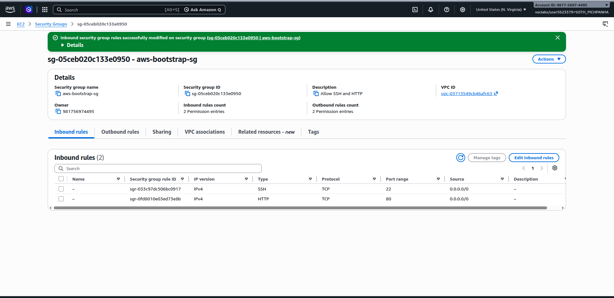
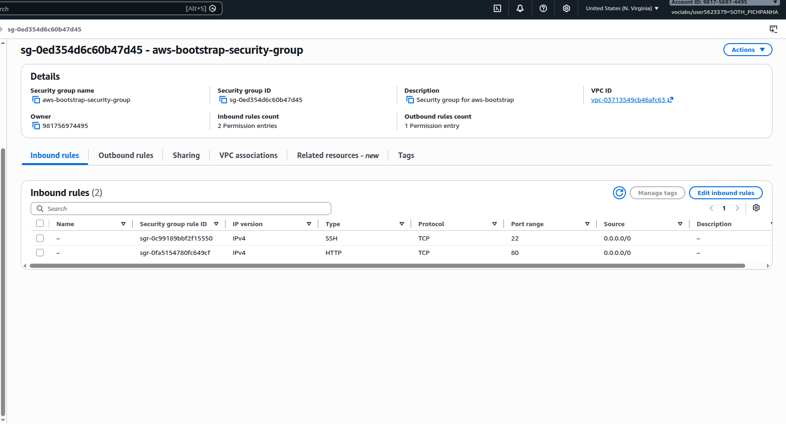
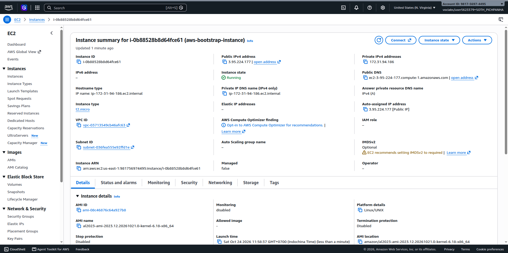
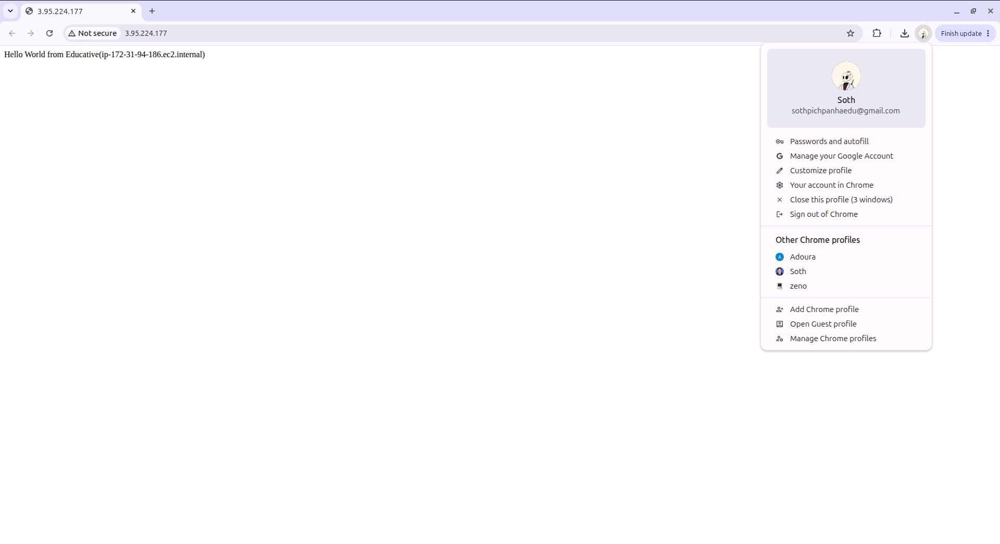
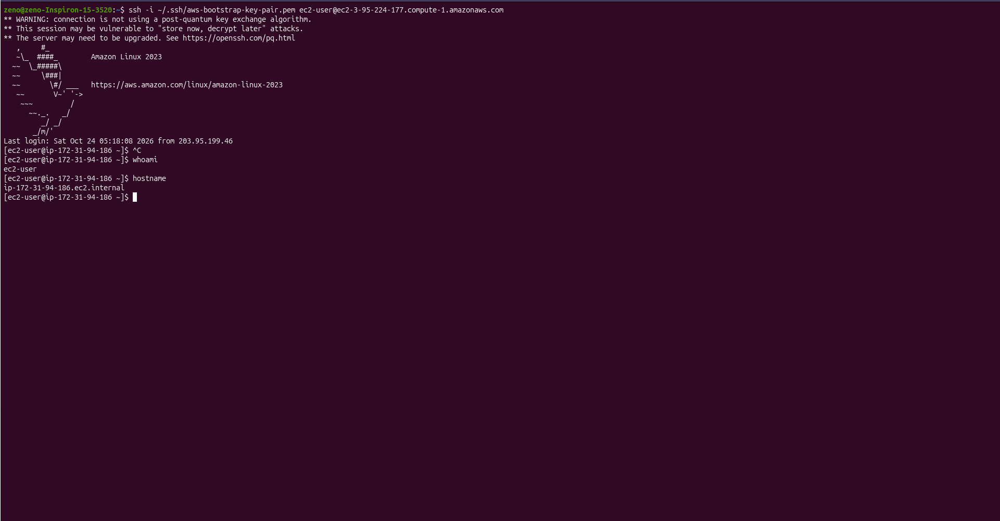
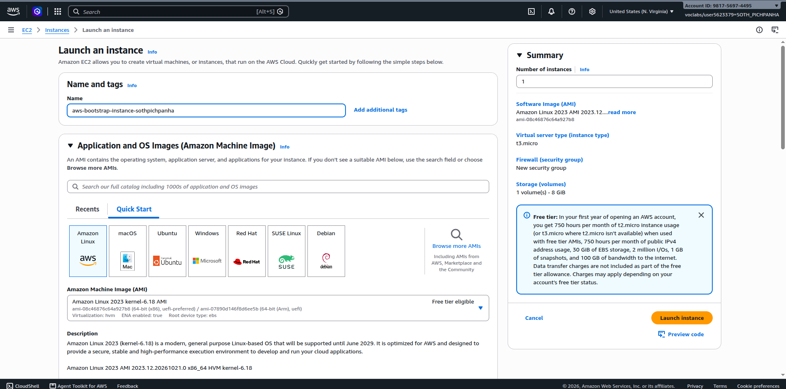
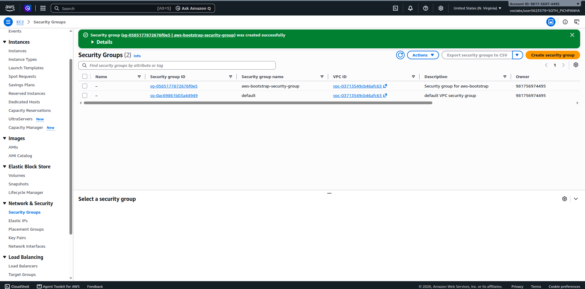
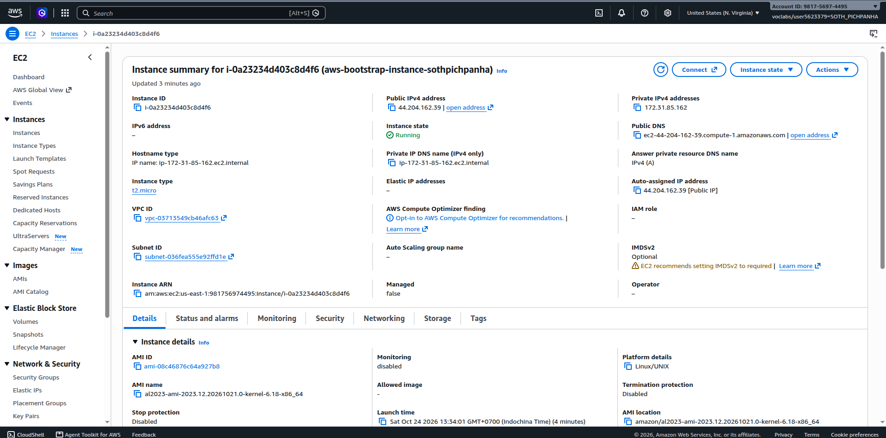
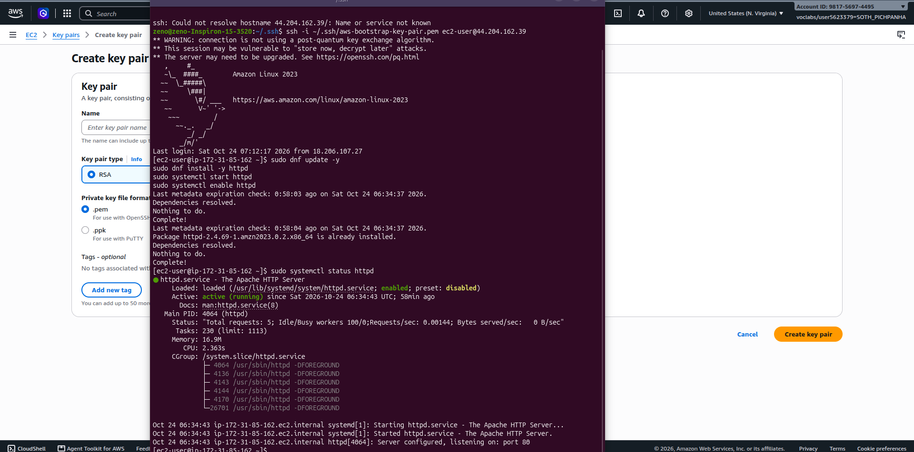
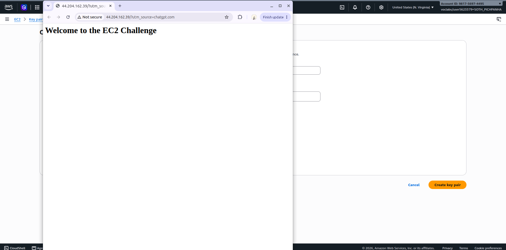

# Cloud Lab 1 Submission — Amazon EC2

Copy this template to `cc-lab-e20221330/lab1/README.md` in your own repository. Follow [the instructions](lab1-instruction.md). Put your screenshots in `lab1/images/` with the file names below.

- **Student name: soth Pichpanha
- **Student ID: e20221330
- **Learner Lab user name: sothpichpanha
- **Date completed: 24-10-2026

---

## Part 1.1 — An Amazon EC2 Walkthrough

### Security group



### Key pair



### Instance details



### Browser test



### SSH connection



Did you connect with your own SSH client or with EC2 Instance Connect?

---

## Part 1.2 — EC2 Web Solution (Challenge)

### Launch configuration



### Security group



### Running instance



### Commands on the instance



Paste the commands you ran to install the web server and create `index.html`:

```bash

```

### Browser test



---

## Questions

1. What do the SSH and HTTP rules allow?
- SSH (Port 22): Allows remote access to the EC2 instance through a terminal to manage the server.
- HTTP (Port 80): Allows users to access the web server through a browser.
If the HTTP rule is deleted, users cannot access the website through HTTP from the internet, but SSH access will still work.
2. What installed the web server, and when did it run?
The User Data script installed the Apache web server automatically when the EC2 instance launched for the first time. The script updated the system, installed Apache, started the service, and created the index.html webpage without requiring manual login.
3. Why does the webpage work with HTTP but not HTTPS?
The webpage works with http:// because Apache is configured to serve HTTP traffic on port 80, and the security group allows it.
HTTPS does not work because the server has not been configured with an SSL/TLS certificate or an HTTPS listener on port 443, and the security group does not have an HTTPS inbound rule.
4. Where did you set the 10 GiB root volume, and how can you check its size?
The 10 GiB root volume was configured in the Configure storage section when launching the EC2 instance by changing the root EBS volume size to 10 GiB.

- [x] Part 1.1: instance terminated, key pair and security group deleted.
- [x] Part 1.2: instance terminated, security group (and key pair, if any) deleted.