# Cloud Lab 2 Submission — Load Balancer and Auto Scaling

Copy this template to `cc-lab-e20221330/lab2/README.md` in your own repository. Follow [the instructions](lab2-instruction.md). Put your screenshots in `lab2/images/` with the file names below.

- **Student name: soth Pichpanha
- **Student ID: e20221330
- **Learner Lab user name: sothpichpanha
- **Date completed: 24-10-2026

---

## Security groups

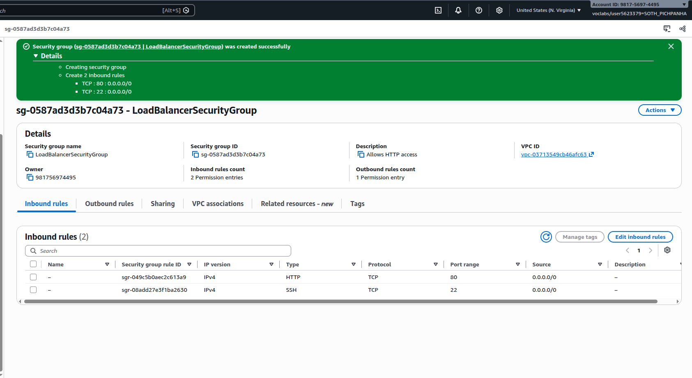

### sg-launch-template
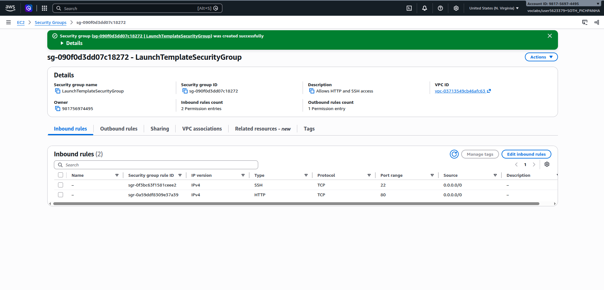

## Target group

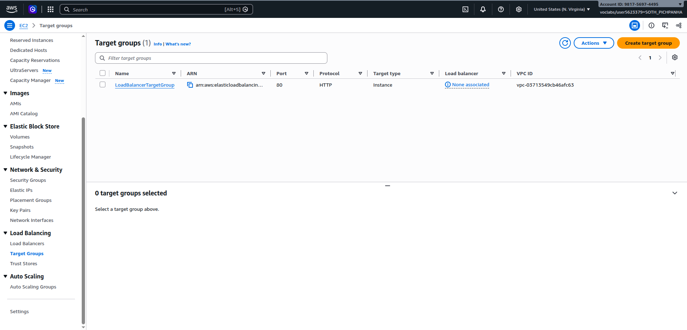
health-checks
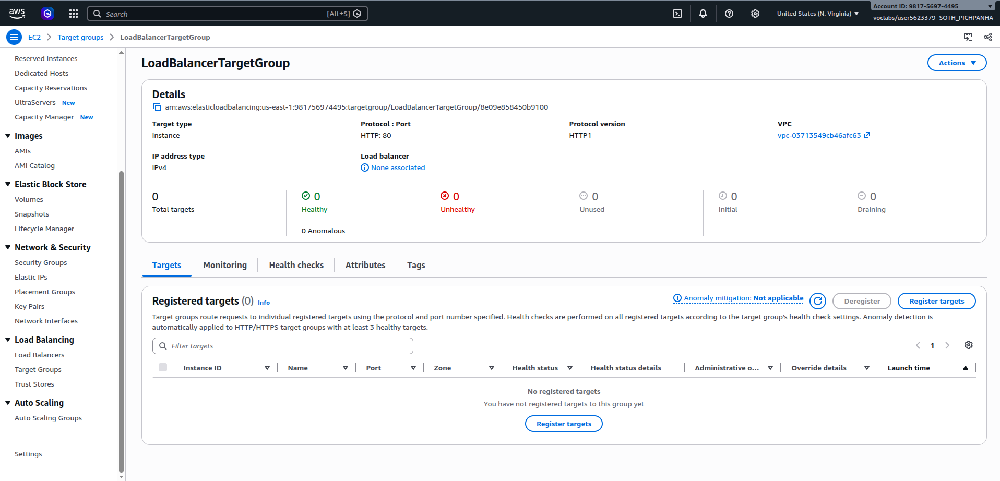

## Application Load Balancer

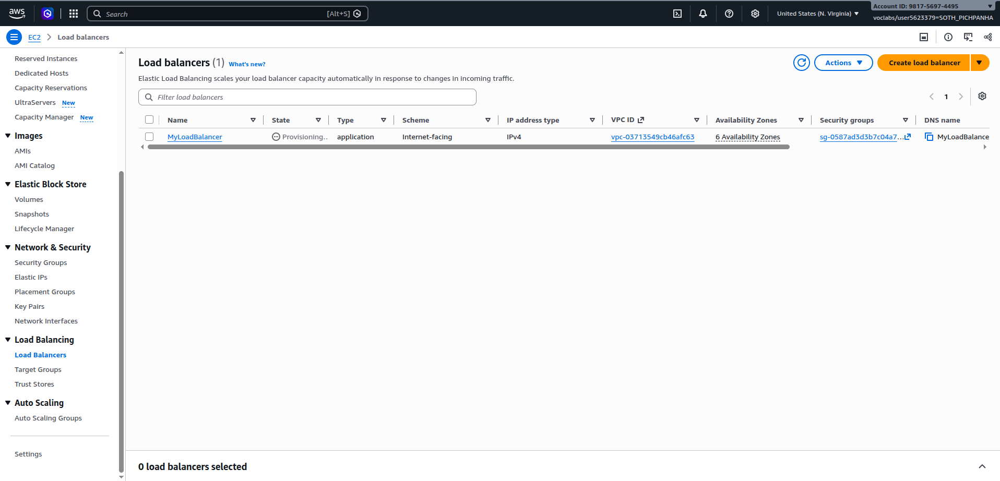

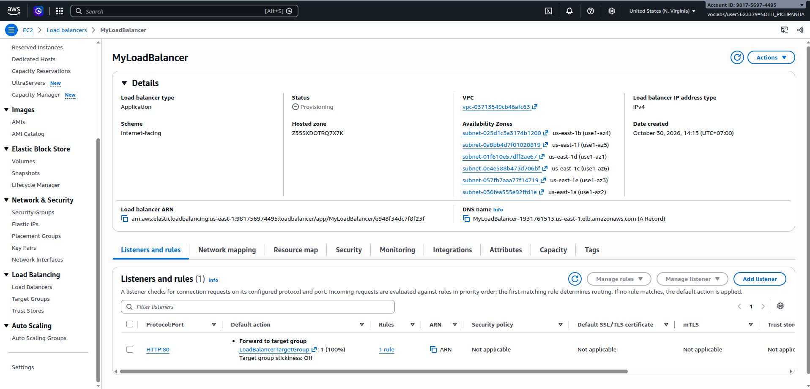

## Launch template 

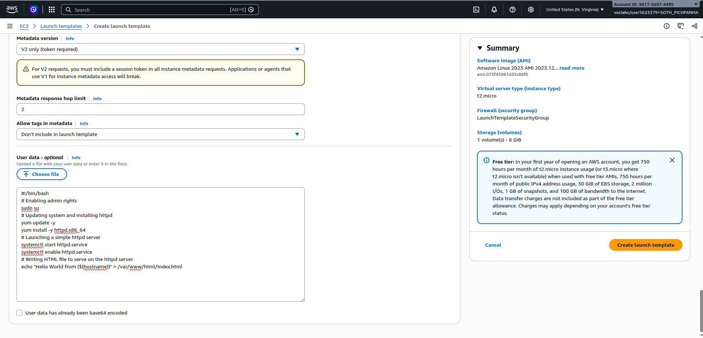

## Auto Scaling group

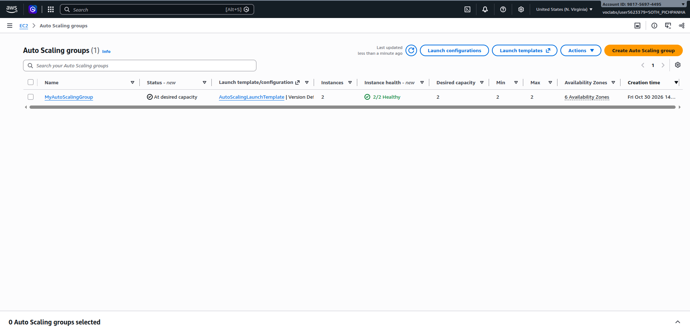

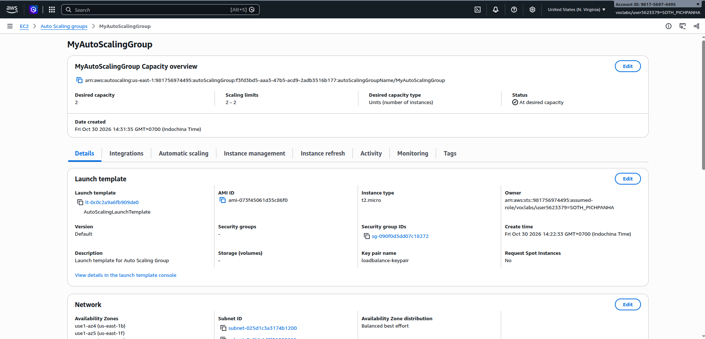

## Load balancing test

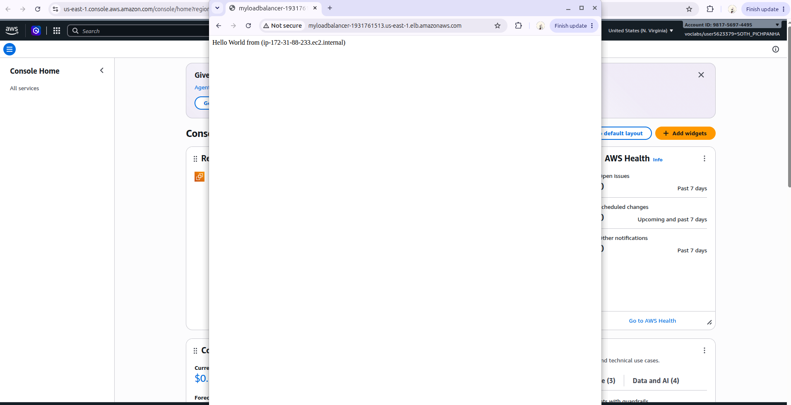

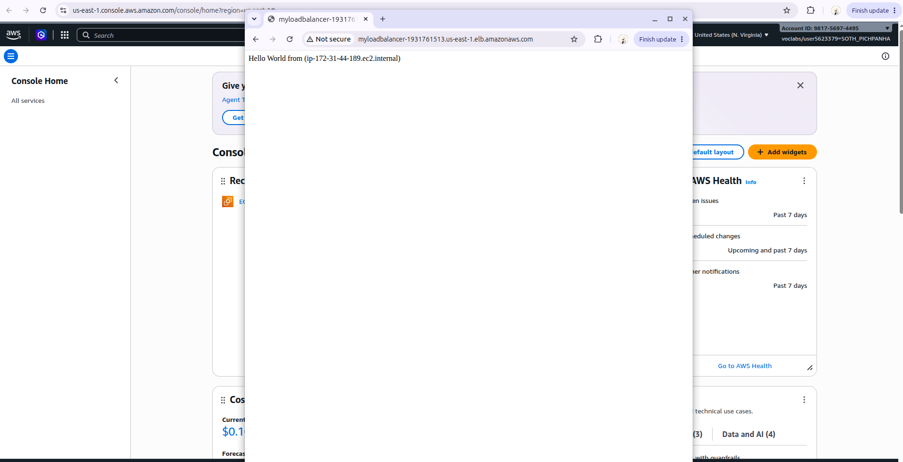

## Simulated application failure

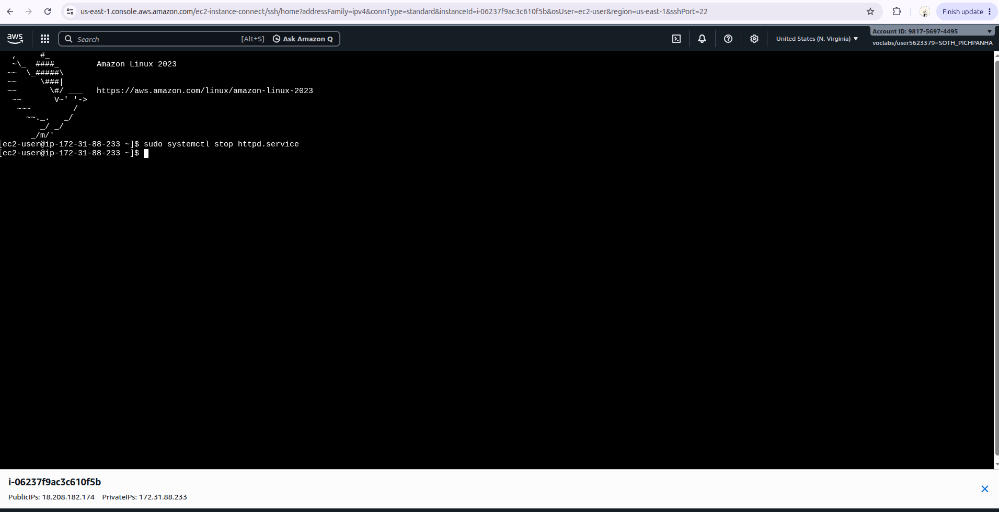

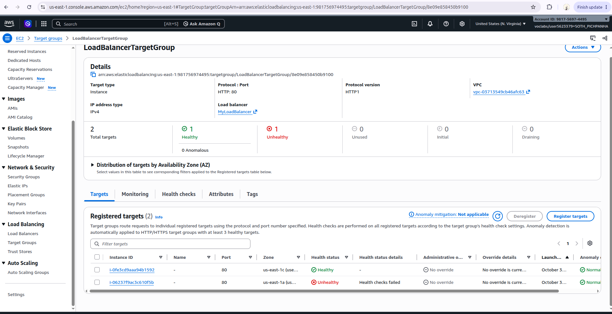

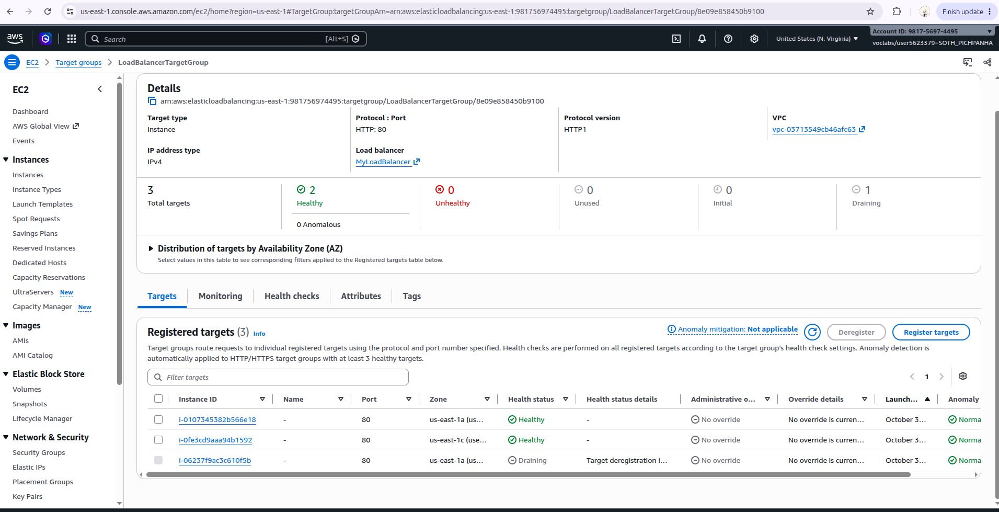

About how many minutes passed between stopping `httpd` and the new instance becoming healthy?

The elapsed time was not recorded, and the screenshots do not show enough timestamps to calculate it. The total includes detecting the failed health checks, launching and initializing the replacement instance, and passing its initial health check.

---

## Questions - Answer

1. Why does the page show a different host name when you refresh it?

   ->The Application Load Balancer distributes requests among the healthy EC2 instances in the target group. Each instance's page displays its own host name, so refreshing can show a different host when another instance handles the request. The default routing algorithm is round robin; every refresh is not guaranteed to show a different host. See [AWS routing algorithms](https://docs.aws.amazon.com/elasticloadbalancing/latest/application/edit-target-group-attributes.html#modify-routing-algorithm).

2. After you stopped `httpd`, the instance was still *running* in EC2, but the target group marked it *unhealthy*. What did the health check test, and why did the instance fail it?

   ->The health check tested whether the web application responded successfully to an HTTP request on its configured health check port and path, rather than just whether the EC2 instance was running. With the default settings for this HTTP target group, this means requesting `/` on port 80 and expecting status code `200`. Stopping `httpd` stopped Apache from serving HTTP, so repeated health checks failed and the target became unhealthy even though its operating system was still running. See [AWS target group health checks](https://docs.aws.amazon.com/elasticloadbalancing/latest/application/target-group-health-checks.html).

3. Who replaced the failed instance: the load balancer, the target group, or the Auto Scaling group? Explain the role of each one.

   ->The **Auto Scaling group** replaced the failed instance using its launch template to maintain the desired capacity. For an application failure such as stopping `httpd` to trigger replacement, Elastic Load Balancing health checks must be enabled for the Auto Scaling group. The **load balancer** performs health checks and routes requests to the remaining healthy targets. The **target group** holds the registered targets and the health check settings and reports each target's health; it does not launch or terminate instances. See [AWS Auto Scaling health checks](https://docs.aws.amazon.com/autoscaling/ec2/userguide/health-checks-overview.html#elastic-load-balancing-health-checks).

4. With desired 2, minimum 2 and maximum 3, how many instances run normally? In what situation could there be 3?

   ->Normally, **2 instances** run because the desired capacity is 2. There could be **3 instances** if a configured scaling policy responds to increased load by raising the desired capacity to 3, or if a scheduled action or manual change sets it to 3. Setting the maximum to 3 only permits scaling up to that size; it does not automatically launch a third instance. See [AWS scaling limits](https://docs.aws.amazon.com/autoscaling/ec2/userguide/asg-capacity-limits.html).

5. The instances' security group allows HTTP from anywhere. How could you change it so that the instances accept HTTP **only** from the load balancer?

   ->Edit the inbound rules of `sg-launch-template`: remove the HTTP rule with source `0.0.0.0/0` (and `::/0` if present), then allow **TCP port 80** with the **load balancer's security group ID** as the source. Ensure no other security group attached to the instances permits HTTP from anywhere. The load balancer's security group must allow outbound traffic to the instances on port 80 for requests and health checks. See [AWS load balancer security groups](https://docs.aws.amazon.com/elasticloadbalancing/latest/application/load-balancer-update-security-groups.html).

- [x] `MyAutoScalingGroup` deleted and its instances terminated.
- [x] `AutoScalingLaunchTemplate` deleted.
- [x] `MyLoadBalancer` and `LoadBalancerTargetGroup` deleted.
- [x] Both security groups deleted.
