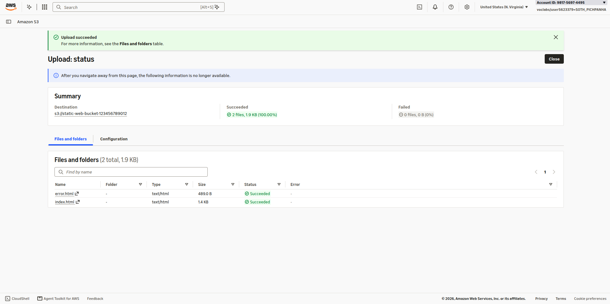
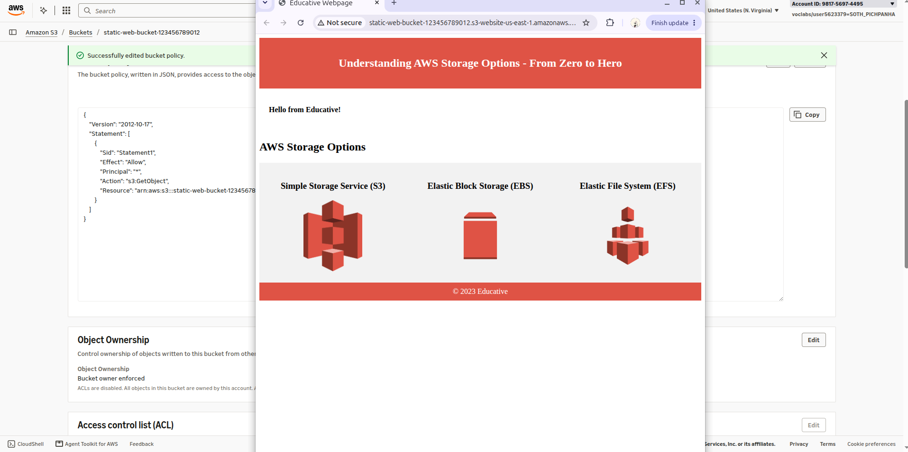
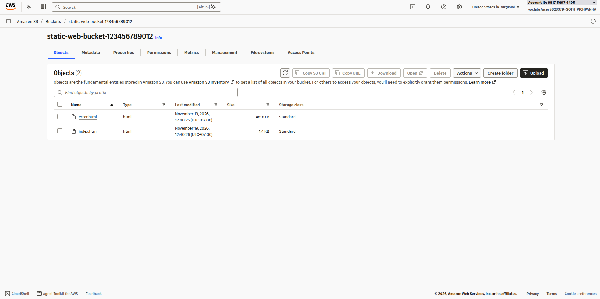
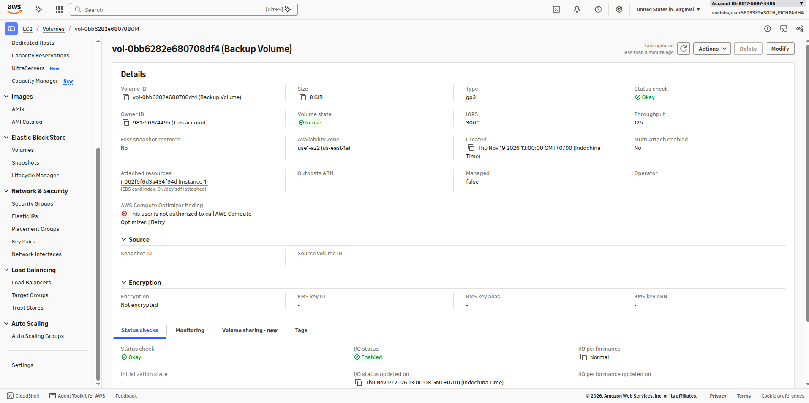
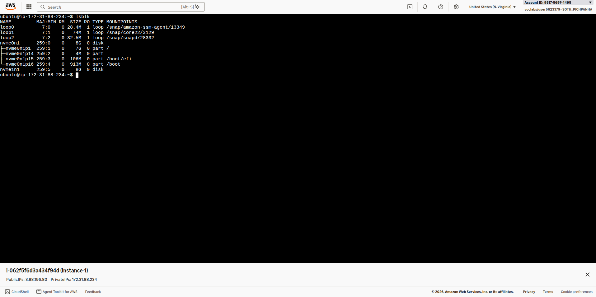
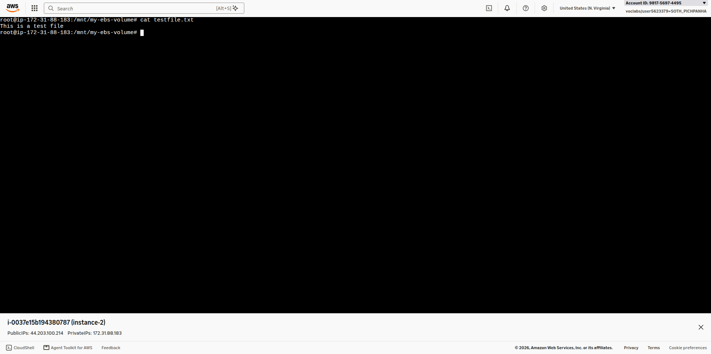
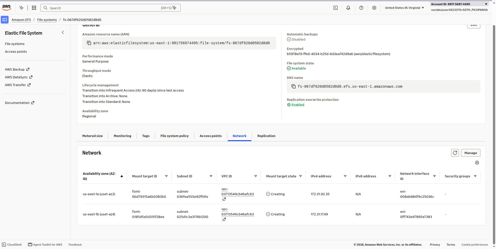
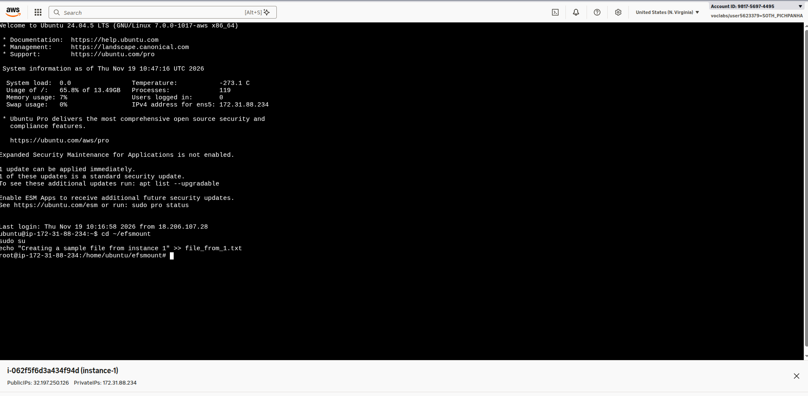
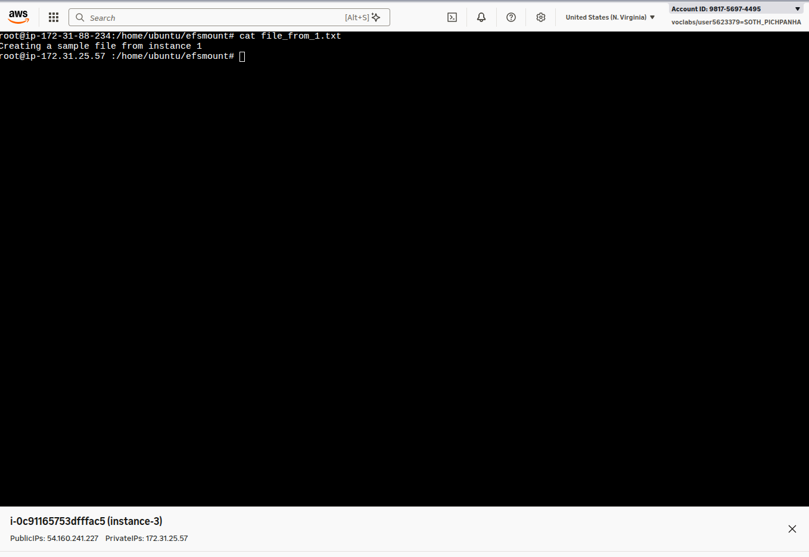

# Cloud Lab 3 Submission — AWS Storage Options

Copy this template to `cc-lab-YOUR_ID/lab3/README.md` in your own repository. Follow [the instructions](lab3-instruction.md). Put your screenshots in `lab3/images/` with the file names below.

- **Student name: soth Pichpanha
- **Student ID: e20221330
- **Learner Lab user name: sothpichpanha
- **Date completed: 19-11-2026

---

## Part 2.1 — Amazon S3

### Bucket list

### Uploaded files

### Static website

---

## Part 2.2 — Amazon EBS

### Volumes page

### Attached volume (`lsblk`)

Which device name did your volume get (`xvdf`, `nvme1n1`, ...)?
`nvme1n1`

### File read on instance-2

---

## Part 2.3 — Amazon EFS

### File system and mount targets

### File created on instance-1

### File listed on instance-3

---

## Answer

1. After you turned on static website hosting, the endpoint first answered **403 Forbidden**. Why, and what changed after you added the bucket policy?

   -> By default, Amazon S3 has "Block Public Access" enabled and all newly created buckets and objects are private with no public read permissions. Even with static website hosting turned on, the objects inside remain inaccessible to anonymous users, resulting in **403 Forbidden**. Adding the bucket policy with `Effect: Allow`, `Principal: "*"`, and `Action: "s3:GetObject"` explicitly granted public read permissions to anyone requesting objects via the static website endpoint, allowing the browser to load the website content.

2. `testfile.txt` was still there after you moved **Backup Volume** to `instance-2`. What would have happened to a file saved on `instance-1`'s **root** volume after terminating `instance-1`?

   -> The file saved on `instance-1`'s root volume would be permanently deleted. By default, the root EBS volume of an EC2 instance has the `DeleteOnTermination` attribute set to `true`, which automatically deletes the volume when the instance is terminated. In contrast, the secondary **Backup Volume** is independent of the instance lifecycle and can be detached and preserved.

3. Why did you run `mkfs` on `instance-1` but not on `instance-2`?

   -> `mkfs` (make file system) formats a raw block storage device by creating a file system (such as `ext4`). This step is only necessary once when the EBS volume is brand new and unformatted. Because EBS volumes retain their formatted file system and data across detach and attach operations, the file system and files created on `instance-1` were already present. Running `mkfs` again on `instance-2` would have formatted the disk and erased `testfile.txt`.

4. Why could `instance-1` and `instance-3` use the EFS file system at the same time, when an EBS volume had to be detached first? Why did they have to be in the subnets of the mount targets?

   -> Amazon EFS is a managed network file system implementing the NFSv4 protocol, designed natively for concurrent shared access across multiple EC2 instances simultaneously over the network. In contrast, a standard EBS volume is a block-level device that can only attach to one EC2 instance at a time (and must be detached before another can attach it). The instances had to reside in the subnets of the mount targets (or have network connectivity to them) because EFS mount targets provide the network interfaces and private IP endpoints in each Availability Zone needed for EC2 instances to connect via NFS.

5. For each need, choose S3, EBS or EFS and give one reason: (a) a website's images, (b) the disk of a database server, (c) a folder shared by several web servers.

   -> **(a) A website's images: S3** — Amazon S3 is an object store optimized for serving static assets over HTTP/HTTPS with high durability, scalability, and built-in integration with CDNs like CloudFront.
   -> **(b) The disk of a database server: EBS** — Amazon EBS provides low-latency, high-throughput, block-level storage directly attached to a single server instance, which is required for database read/write transactions.
   -> **(c) A folder shared by several web servers: EFS** — Amazon EFS provides a POSIX-compliant shared network file system (NFS) that can be mounted simultaneously by multiple web servers for concurrent access.

## Problems and how I solved them (optional)

## AI note (optional)

One suggestion an AI tool gave you and how you checked it.

## Clean up

- [x] Instances `instance-1`, `instance-2`, `instance-3` terminated.
- [x] `clab-efs` and **Backup Volume** deleted.
- [x] Security groups `efs-sg` and `ec2instances-sg` deleted.
- [x] S3 bucket emptied and deleted.