# Cloud Lab 4 Submission — Amazon VPC

Copy this template to `cc-lab-YOUR_ID/lab4/README.md` in your own repository. Follow [the instructions](lab4-instruction.md). Put your screenshots in `lab4/images/` with the file names below.

- **Student name:**
- **Student ID:**
- **Learner Lab user name:**
- **Date completed:**

---

## VPC and internet gateway

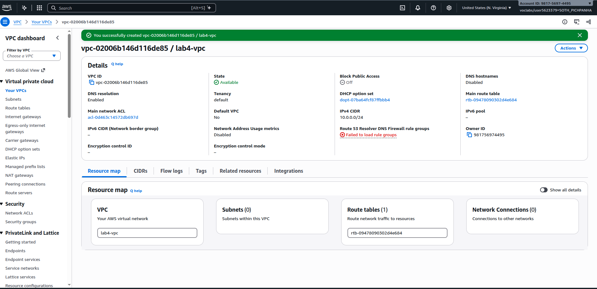

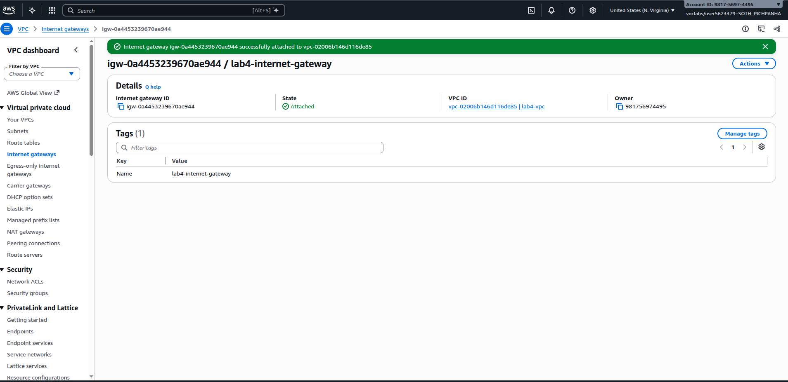

## Public subnet

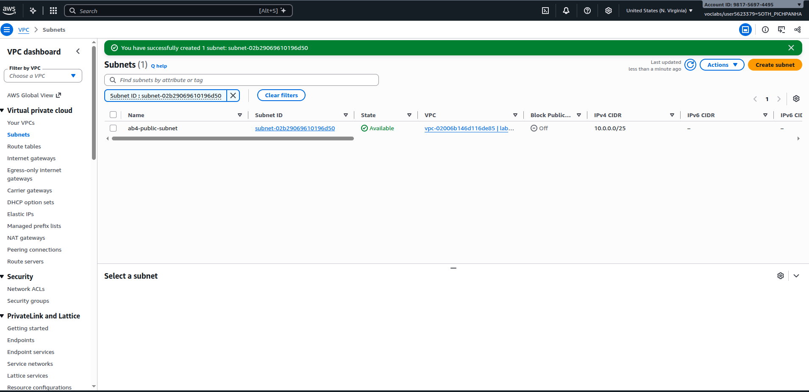

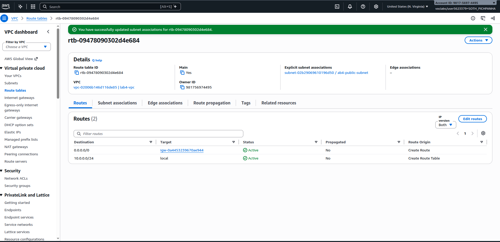

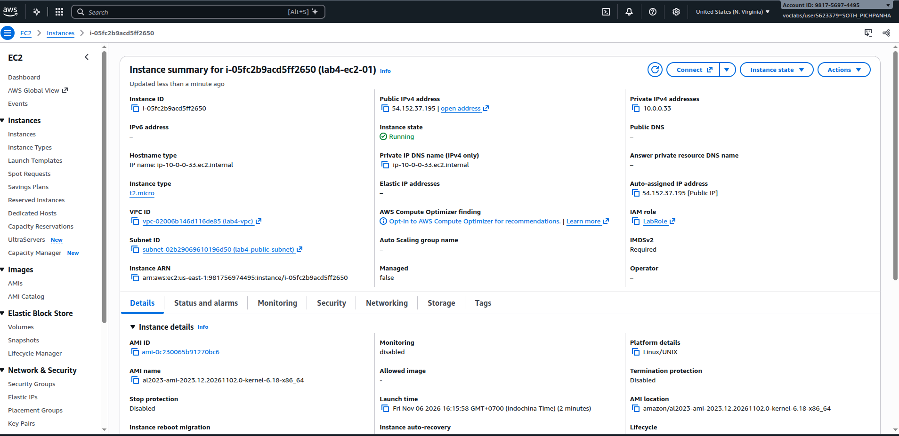

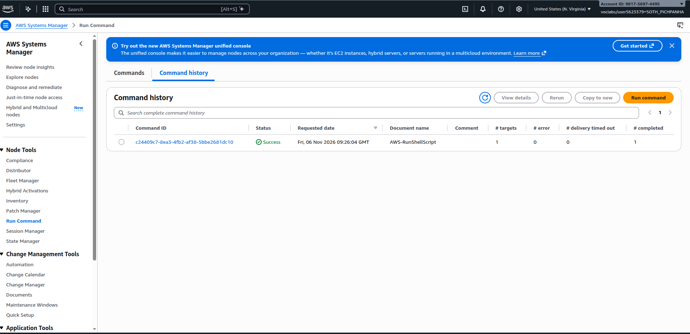

## Private subnet

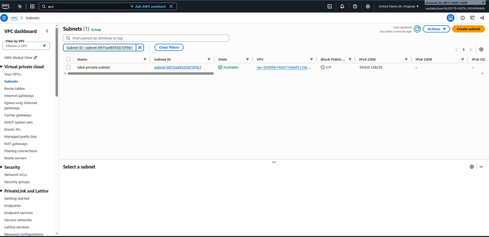

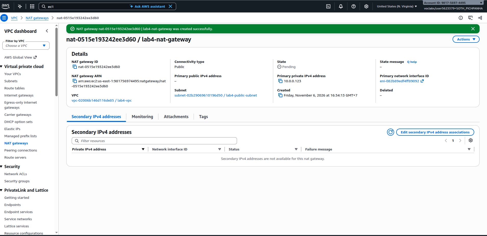

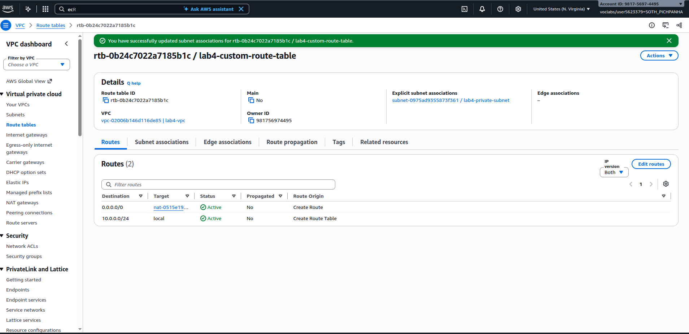

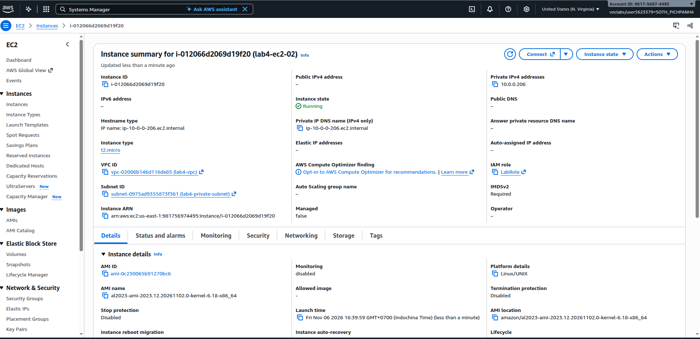

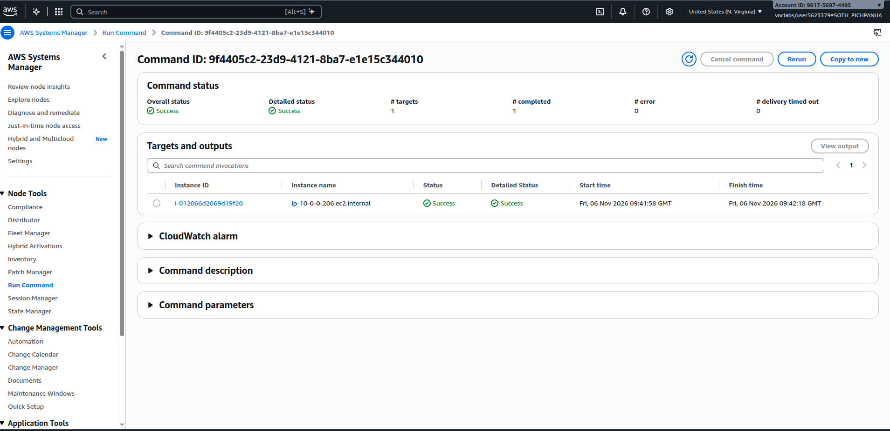

---

## Questions

1. The VPC is `10.0.0.0/24` and the subnets are `10.0.0.0/25` and `10.0.0.128/25`. How many IP addresses does each block contain, and why do the two subnets not overlap?

   - **VPC (`10.0.0.0/24`):** Contains **256 IP addresses** ($2^{32-24} = 2^8 = 256$, range: `10.0.0.0` – `10.0.0.255`).
   - **Each Subnet (`/25`):** Contains **128 IP addresses** ($2^{32-25} = 2^7 = 128$). In AWS, 5 IP addresses per subnet are reserved for networking infrastructure, leaving **123 usable IP addresses** in each subnet.
   - **Why they do not overlap:** The 25th bit splits the `/24` block into two distinct ranges:
     - `10.0.0.0/25` covers `10.0.0.0` to `10.0.0.127` (where the 25th bit in the 4th octet is `0`: `00000000` to `01111111`).
     - `10.0.0.128/25` covers `10.0.0.128` to `10.0.0.255` (where the 25th bit in the 4th octet is `1`: `10000000` to `11111111`).
     Because the two address ranges are completely disjoint, they do not overlap.

2. Both subnets are in the same VPC. What exactly makes `lab4-public-subnet` public and `lab4-private-subnet` private?

   The distinction is determined entirely by the **route table** associated with each subnet:
   - **`lab4-public-subnet` is public** because its associated route table has a default route (`0.0.0.0/0`) pointing directly to an **Internet Gateway (IGW)** (`igw-xxxxxx`). Resources here can also be assigned public IP addresses to send and receive traffic directly to/from the internet.
   - **`lab4-private-subnet` is private** because its route table does **not** route `0.0.0.0/0` directly to an Internet Gateway. Instead, outbound internet traffic is routed to a **NAT Gateway** (or has no internet route), and instances in it have only private IP addresses not directly accessible from the internet.

3. Why is the NAT gateway placed in the **public** subnet and not in the private one?

   A NAT Gateway acts as a bridge that enables instances in the private subnet to reach the internet while blocking incoming traffic from the outside. To communicate with the internet, the NAT Gateway itself requires:
   1. An allocated **Elastic IP (public IPv4 address)**.
   2. A route table with a default route directing `0.0.0.0/0` to an **Internet Gateway (IGW)**.

   Only the public subnet has direct access to the Internet Gateway. If the NAT Gateway were placed in the private subnet, it would have no route to reach the Internet Gateway, rendering it unable to access the internet.

4. `lab4-ec2-02` has no public IP address. Can someone on the internet open a connection to it? Can it download updates? Explain both answers.

   - **Can someone on the internet open a connection to it? No.** `lab4-ec2-02` only has a private IP address, which is not routable on the public internet. In addition, the NAT Gateway is stateful and strictly unidirectional: it allows outbound-initiated traffic and its return packets, but automatically drops any unsolicited inbound connection requests from the internet.
   - **Can it download updates? Yes.** When `lab4-ec2-02` initiates outbound traffic (such as downloading updates), the private subnet's route table directs `0.0.0.0/0` to the **NAT Gateway** in the public subnet. The NAT Gateway performs Source NAT (SNAT) using its Elastic IP, sends the request to the internet via the Internet Gateway, and forwards the response packets back to `lab4-ec2-02`.

5. You tested internet access with Systems Manager instead of SSH. Why did the instances need `LabInstanceProfile` for this?

   AWS Systems Manager (SSM) Session Manager does not require open inbound ports (like SSH port 22). Instead, the `amazon-ssm-agent` installed on the instance initiates outbound HTTPS requests to the AWS Systems Manager service endpoints. To authenticate and authorize these API actions (such as registering the instance, polling for commands, and streaming session data), the agent needs IAM permissions (like `AmazonSSMManagedInstanceCore`). Attaching the **`LabInstanceProfile`** provides these temporary IAM credentials to the EC2 instance via the instance metadata service, allowing Session Manager to manage and connect to it.

## Problems and how I solved them (optional)

## AI note (optional)

One suggestion an AI tool gave you and how you checked it.

## Clean up

- [x] Instances terminated.
- [x] NAT gateway deleted and its Elastic IP released.
- [x] Internet gateway detached and deleted.
- [x] `lab4-vpc` deleted.